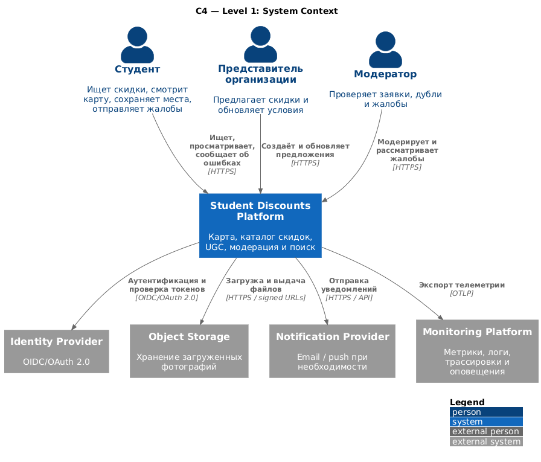
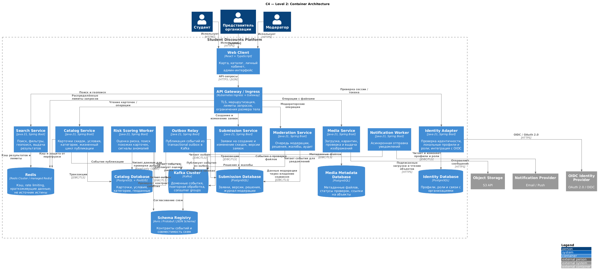
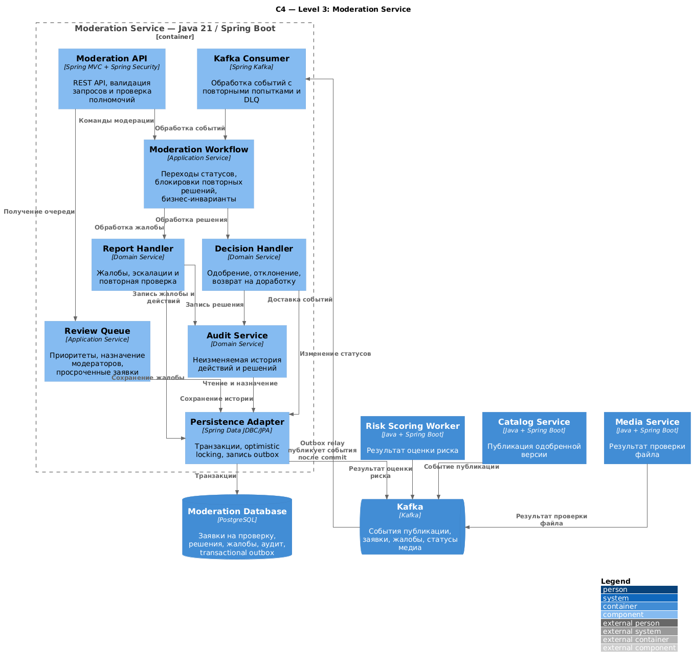
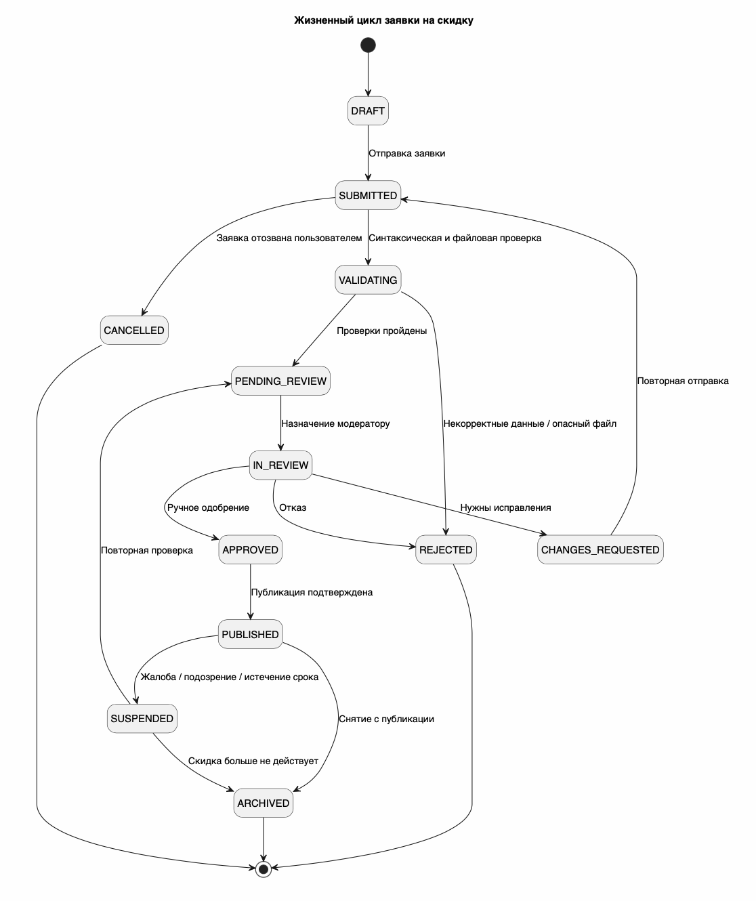
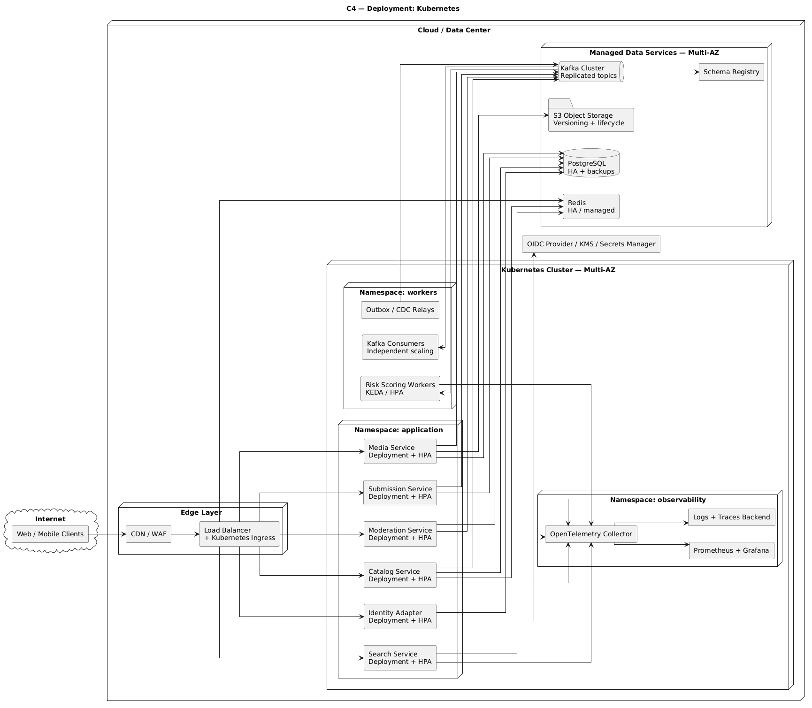

# C4 — Архитектура платформы студенческих скидок

## Архитектурные решения

| Область                   | Решение                                                                                |
| ------------------------- | -------------------------------------------------------------------------------------- |
| Язык и runtime            | Java 21 LTS, Spring Boot 3.x или актуальная поддерживаемая версия на момент реализации |
| API                       | Spring MVC для обычных HTTP API; Spring Security, Bean Validation, OpenAPI             |
| Внутренние вызовы         | REST/gRPC только там, где оправдан синхронный запрос; Kafka для событий                |
| База данных               | PostgreSQL с PostGIS, Flyway для миграций                                              |
| Кэш и ограничение частоты | Redis, TTL, лимиты, защита от cache stampede                                           |
| События                   | Kafka, Schema Registry, версионирование схем и DLQ                                     |
| Оркестрация               | Kubernetes, Helm, HPA, PodDisruptionBudget, NetworkPolicy                              |
| Входящий трафик           | WAF/CDN при необходимости, Ingress/Gateway, TLS                                        |
| Наблюдаемость             | OpenTelemetry, Prometheus, Grafana, централизованные логи и трассировка                |
| Секреты                   | External Secrets/Secrets Store CSI + облачный KMS или Vault                            |
| Файлы                     | S3-совместимое объектное хранилище с карантином и проверкой загрузок                   |
| CI/CD                     | Сборка, тесты, сканирование зависимостей и образов, SBOM, подписанные образы, GitOps   |

Принцип: микросервисы разделяются по бизнес-возможностям и владению данными, а не по каждой таблице. У каждого сервиса своя схема или своя база и собственный контракт. Не использовать общую транзакционную БД, к которой все сервисы напрямую обращаются для изменения данных.

## C4 Level 1 — System Context
Показывает систему как единый продукт, пользователей и внешние системы, с которыми она взаимодействует.

<!-- @startuml C4_Context_StudentDiscounts
!include https://raw.githubusercontent.com/plantuml-stdlib/C4-PlantUML/master/C4_Context.puml

title C4 — Level 1: System Context
LAYOUT_WITH_LEGEND()
SHOW_PERSON_PORTRAIT()

Person(student, "Студент", "Ищет скидки, смотрит карту, сохраняет места, отправляет жалобы")
Person(orgRep, "Представитель организации", "Предлагает скидки и обновляет условия")
Person(moderator, "Модератор", "Проверяет заявки, дубли и жалобы")
System(platform, "Student Discounts Platform", "Карта, каталог скидок, UGC, модерация и поиск")

System_Ext(idp, "Identity Provider", "OIDC/OAuth 2.0")
System_Ext(objectStorage, "Object Storage", "Хранение загруженных фотографий")
System_Ext(notifications, "Notification Provider", "Email / push при необходимости")
System_Ext(monitoring, "Monitoring Platform", "Метрики, логи, трассировки и оповещения")

Rel(student, platform, "Ищет, просматривает, сообщает об ошибках", "HTTPS")
Rel(orgRep, platform, "Создаёт и обновляет предложения", "HTTPS")
Rel(moderator, platform, "Модерирует и рассматривает жалобы", "HTTPS")
Rel(platform, idp, "Аутентификация и проверка токенов", "OIDC/OAuth 2.0")
Rel(platform, objectStorage, "Загрузка и выдача файлов", "HTTPS / signed URLs")
Rel(platform, notifications, "Отправка уведомлений", "HTTPS / API")
Rel(platform, monitoring, "Экспорт телеметрии", "OTLP")

@enduml-->

## C4 Level 2 — Container Diagram

Основная диаграмма архитектуры. Она показывает исполняемые приложения, брокер сообщений, хранилища и границы Kubernetes-кластера.

<!--
@startuml C4_Container_StudentDiscounts
!include https://raw.githubusercontent.com/plantuml-stdlib/C4-PlantUML/master/C4_Container.puml

title C4 — Level 2: Container Architecture
LAYOUT_WITH_LEGEND()
skinparam linetype ortho

Person(student, "Студент")
Person(orgRep, "Представитель организации")
Person(moderator, "Модератор")

System_Ext(idp, "OIDC Identity Provider", "OAuth 2.0 / OIDC")
System_Ext(s3, "Object Storage", "S3 API")
System_Ext(mail, "Notification Provider", "Email / Push")

System_Boundary(platform, "Student Discounts Platform") {
    Container(web, "Web Client", "React + TypeScript", "Карта, каталог, личный кабинет, админ-интерфейс")

    Container(edge, "API Gateway / Ingress", "Kubernetes Ingress + Gateway", "TLS, маршрутизация, лимиты запросов, ограничения размера тела")

    Container(auth, "Identity Adapter", "Java 21, Spring Boot", "Проверка идентичности, локальные профили и роли; интеграция с OIDC")

    Container(catalog, "Catalog Service", "Java 21, Spring Boot", "Карточки скидок, условия, категории, жизненный цикл публикации")
    Container(search, "Search Service", "Java 21, Spring Boot", "Поиск, фильтры, геопоиск, выдача результатов")
    Container(submission, "Submission Service", "Java 21, Spring Boot", "Заявки на создание и изменение скидок, версии заявок")
    Container(moderation, "Moderation Service", "Java 21, Spring Boot", "Очередь модерации, решения, жалобы, аудит")
    Container(risk, "Risk Scoring Worker", "Java 21, Spring Boot", "Оценка риска, поиск похожих карточек, сигналы аномалий")
    Container(media, "Media Service", "Java 21, Spring Boot", "Загрузка, карантин, проверка и выдача изображений")
    Container(notification, "Notification Worker", "Java 21, Spring Boot", "Асинхронная отправка уведомлений")
    Container(outbox, "Outbox Relay", "Java 21, Spring Boot", "Публикация событий из transactional outbox в Kafka")

    ContainerDb(pgCatalog, "Catalog Database", "PostgreSQL + PostGIS", "Карточки, условия, категории, геоданные")
    ContainerDb(pgSubmission, "Submission Database", "PostgreSQL", "Заявки, версии, решения, журнал модерации")
    ContainerDb(pgIdentity, "Identity Database", "PostgreSQL", "Профили, роли и связи с организациями")
    ContainerDb(pgMedia, "Media Metadata Database", "PostgreSQL", "Метаданные файлов, статусы проверок, ссылки на объекты")

    ContainerDb(redis, "Redis", "Redis Cluster / managed Redis", "Кэш, rate limiting, краткоживущие данные; не источник истины")
    ContainerQueue(kafka, "Kafka Cluster", "Kafka", "Доменные события, повторная обработка, consumer groups")
    ContainerDb(schema, "Schema Registry", "Avro / Protobuf / JSON Schema", "Контракты событий и совместимость схем")
}

Rel(student, web, "Использует", "HTTPS")
Rel(orgRep, web, "Использует", "HTTPS")
Rel(moderator, web, "Использует", "HTTPS")
Rel(web, edge, "API-запросы", "HTTPS / JSON")
Rel(edge, auth, "Проверка сессии / токена")
Rel(edge, catalog, "Чтение карточек / операции")
Rel(edge, search, "Поиск и геопоиск")
Rel(edge, submission, "Создание и изменение заявок")
Rel(edge, moderation, "Модераторские операции")
Rel(edge, media, "Операции с файлами")

Rel(auth, idp, "OIDC / OAuth 2.0", "HTTPS")
Rel(auth, pgIdentity, "Читает и изменяет профили и роли", "JDBC/TLS")

Rel(catalog, pgCatalog, "Транзакции", "JDBC/TLS")
Rel(submission, pgSubmission, "Транзакции", "JDBC/TLS")
Rel(moderation, pgSubmission, "Данные модерации через владение сервисом", "JDBC/TLS")
Rel(media, pgMedia, "Метаданные файлов", "JDBC/TLS")
Rel(media, s3, "Подписанные загрузки и чтение объектов", "HTTPS")
Rel(media, kafka, "События о проверке файлов")
Rel(submission, kafka, "События о заявках")
Rel(moderation, kafka, "Решения и жалобы")
Rel(catalog, kafka, "События публикации")
Rel(risk, kafka, "Читает события, публикует оценку риска")
Rel(notification, kafka, "Читает события для уведомлений")
Rel(notification, mail, "Отправляет сообщения", "HTTPS")
Rel(outbox, kafka, "Публикует события из outbox")
Rel(outbox, pgCatalog, "Читает outbox", "JDBC/TLS")
Rel(outbox, pgSubmission, "Читает outbox", "JDBC/TLS")
Rel(catalog, redis, "Кэш и защита от перегрузки")
Rel(search, redis, "Кэш результатов и лимиты")
Rel(edge, redis, "Распределённые лимиты запросов")
Rel(risk, pgCatalog, "Читает данные для проверки дублей", "Read-only / JDBC")
Rel(risk, schema, "Проверяет контракт события")
Rel(kafka, schema, "Согласование схем")

@enduml
-->

### Важные уточнения к схеме

1. Identity Adapter не должен самостоятельно реализовывать криптографию OAuth/OIDC. Подпись, issuer, audience, срок действия и ключи токена валидируются стандартными библиотеками Spring Security. Пароли, если локальная аутентификация вообще поддерживается, не хранятся в открытом виде.
2. Модерация должна иметь единственного владельца данных. В `Moderation Service` владеет решениями, жалобами и журналом модерации. Если эти данные выделяются из `Submission Database`, следует создать отдельную `Moderation Database`; прямой доступ к чужим таблицам нужно исключить.
3. Outbox Relay не должен читать произвольные таблицы других сервисов. На практике каждый сервис публикует события из собственной transactional outbox. На диаграмме показана упрощённая схема; Предпочтительны отдельные relay/CDC-процессы для каждого владельца данных.
4. Kafka не заменяет PostgreSQL. Транзакционные данные и бизнес-инварианты остаются в БД. Kafka передаёт события и позволяет независимо масштабировать потребителей.
5. Redis не является источником истины. Потеря или очистка кэша не должна приводить к потере заявок, ролей или опубликованных скидок.

## C4 Level 3 — внутреннее устройство сервиса модерации

Этот уровень раскрывает критичный бизнес-процесс: заявка не становится публичной только потому, что автоматический скоринг признал её низкорисковой.

<!-- 
@startuml C4_Component_Moderation
!include https://raw.githubusercontent.com/plantuml-stdlib/C4-PlantUML/master/C4_Component.puml

title C4 — Level 3: Moderation Service
LAYOUT_WITH_LEGEND()
skinparam linetype ortho

Container_Boundary(ms, "Moderation Service — Java 21 / Spring Boot") {
    Component(api, "Moderation API", "Spring MVC + Spring Security", "REST API, валидация запросов и проверка полномочий")
    Component(workflow, "Moderation Workflow", "Application Service", "Переходы статусов, блокировки повторных решений, бизнес-инварианты")
    Component(queue, "Review Queue", "Application Service", "Приоритеты, назначение модераторов, просроченные заявки")
    Component(decision, "Decision Handler", "Domain Service", "Одобрение, отклонение, возврат на доработку")
    Component(report, "Report Handler", "Domain Service", "Жалобы, эскалации и повторная проверка")
    Component(audit, "Audit Service", "Domain Service", "Неизменяемая история действий и решений")
    Component(repo, "Persistence Adapter", "Spring Data JDBC/JPA", "Транзакции, optimistic locking, запись outbox")
    Component(consumer, "Kafka Consumer", "Spring Kafka", "Обработка событий с повторными попытками и DLQ")
}

ContainerDb(db, "Moderation Database", "PostgreSQL", "Заявки на проверку, решения, жалобы, аудит, transactional outbox")
ContainerQueue(kafka, "Kafka", "Kafka", "События публикации, заявки, жалобы, статусы медиа")
Container(risk, "Risk Scoring Worker", "Java + Spring Boot", "Результат оценки риска")
Container(catalog, "Catalog Service", "Java + Spring Boot", "Публикация одобренной версии")
Container(media, "Media Service", "Java + Spring Boot", "Результат проверки файла")

Rel(api, workflow, "Команды модерации")
Rel(api, queue, "Получение очереди")
Rel(workflow, decision, "Обработка решения")
Rel(workflow, report, "Обработка жалобы")
Rel(decision, audit, "Запись решения")
Rel(report, audit, "Запись жалобы и действий")
Rel(queue, repo, "Чтение и назначение")
Rel(decision, repo, "Изменение статусов")
Rel(report, repo, "Сохранение жалобы")
Rel(audit, repo, "Сохранение истории")
Rel(repo, db, "Транзакции")
Rel(repo, kafka, "Outbox relay публикует события после commit")
Rel(consumer, workflow, "Обработка событий")
Rel(kafka, consumer, "Доставка событий")
Rel(risk, kafka, "Результат оценки риска")
Rel(media, kafka, "Результат проверки файла")
Rel(catalog, kafka, "Событие публикации")

@enduml
-->

### Правила переходов статусов

Рекомендуемая модель состояния заявки:

<!-- hide empty description -->
<!---->
<!-- [*] --/> DRAFT -->
<!-- DRAFT --/> SUBMITTED : Отправка заявки -->
<!-- SUBMITTED --/> VALIDATING : Синтаксическая и файловая проверка -->
<!-- SUBMITTED --/> CANCELLED : Заявка отозвана пользователем -->
<!-- VALIDATING --/> REJECTED : Некорректные данные / опасный файл -->
<!-- VALIDATING --/> PENDING_REVIEW : Проверки пройдены -->
<!-- PENDING_REVIEW --/> IN_REVIEW : Назначение модератору -->
<!-- IN_REVIEW --/> APPROVED : Ручное одобрение -->
<!-- IN_REVIEW --/> CHANGES_REQUESTED : Нужны исправления -->
<!-- IN_REVIEW --/> REJECTED : Отказ -->
<!-- CHANGES_REQUESTED --/> SUBMITTED : Повторная отправка -->
<!-- APPROVED --/> PUBLISHED : Публикация подтверждена -->
<!-- PUBLISHED --/> SUSPENDED : Жалоба / подозрение / истечение срока -->
<!-- SUSPENDED --/> PENDING_REVIEW : Повторная проверка -->
<!-- SUSPENDED --/> ARCHIVED : Скидка больше не действует -->
<!-- PUBLISHED --/> ARCHIVED : Снятие с публикации -->
<!-- REJECTED --/> [*] -->
<!-- ARCHIVED --/> [*] -->
<!-- CANCELLED --/> [*] -->
<!-- @enduml -->
<!---->
Состояния `APPROVED` и `PUBLISHED` разделены намеренно: решение о модерации и фактическая доступность карточки пользователям — разные операции. Например, публикация может ожидать проверки файла или обработки события.

## C4 Level 2 — развёртывание в Kubernetes

Нужно учитывать не только логическую архитектуру, но и отказоустойчивость, изоляцию нагрузки и безопасное обновление приложений.

<!-- @startuml C4_Deployment_StudentDiscounts
title C4 — Deployment: Kubernetes
left to right direction
skinparam shadowing false
skinparam linetype ortho
skinparam packageStyle rectangle

cloud "Internet" {
  rectangle "Web / Mobile Clients" as clients
}

node "Cloud / Data Center" {
  node "Edge Layer" {
    rectangle "CDN / WAF" as waf
    rectangle "Load Balancer\n+ Kubernetes Ingress" as ingress
  }

  node "Kubernetes Cluster — Multi-AZ" {
    node "Namespace: application" {
      rectangle "Catalog Service\nDeployment + HPA" as catalog
      rectangle "Search Service\nDeployment + HPA" as search
      rectangle "Submission Service\nDeployment + HPA" as submission
      rectangle "Moderation Service\nDeployment + HPA" as moderation
      rectangle "Identity Adapter\nDeployment + HPA" as identity
      rectangle "Media Service\nDeployment + HPA" as media
    }

    node "Namespace: workers" {
      rectangle "Risk Scoring Workers\nKEDA / HPA" as risk
      rectangle "Kafka Consumers\nIndependent scaling" as consumers
      rectangle "Outbox / CDC Relays" as relays
    }

    node "Namespace: observability" {
      rectangle "OpenTelemetry Collector" as otel
      rectangle "Prometheus + Grafana" as metrics
      rectangle "Logs + Traces Backend" as logs
    }
  }

  node "Managed Data Services — Multi-AZ" {
    database "PostgreSQL\nHA + backups" as pg
    rectangle "Redis\nHA / managed" as redis
    queue "Kafka Cluster\nReplicated topics" as kafka
    rectangle "Schema Registry" as schema
    folder "S3 Object Storage\nVersioning + lifecycle" as s3
  }

  rectangle "OIDC Provider / KMS / Secrets Manager" as security
}

clients --/> waf
waf --/> ingress
ingress --/> catalog
ingress --/> search
ingress --/> submission
ingress --/> moderation
ingress --/> identity
ingress --/> media

catalog --/> pg
submission --/> pg
moderation --/> pg
identity --/> pg
media --/> pg

catalog --/> redis
search --/> redis
ingress --/> redis

catalog --/> kafka
submission --/> kafka
moderation --/> kafka
media --/> kafka
relays --/> kafka
kafka --/> consumers
kafka --/> risk
kafka --/> schema

media --/> s3
identity --/> security

catalog --/> otel
search --/> otel
submission --/> otel
moderation --/> otel
risk --/> otel
otel --/> metrics
otel --/> logs

@enduml -->

Диаграмма логическая: количество кластеров, регионов, реплик и конкретные managed-сервисы выбираются после выбора облака и нагрузочного тестирования. Для отказоустойчивости production-кластер и критичные зависимости должны быть распределены по зонам доступности.
## Наблюдаемость и SLO

| Метрика                          | Начальная цель                                                |
| -------------------------------- | ------------------------------------------------------------- |
| Доступность публичного API       | 99,9% в месяц                                                 |
| Чтение карточек и поиск          | p95 до 300 мс, p99 до 800 мс                                  |
| Запись заявки                    | p95 до 500 мс, без ожидания ручной модерации                  |
| Потеря подтверждённых транзакций | RPO до 5 минут как начальная цель                             |
| Восстановление сервиса           | RTO до 60 минут как начальная цель                            |
| Kafka                            | Контроль lag, возраста старейшего сообщения и DLQ             |
| PostgreSQL                       | Контроль latency, блокировок, соединений и медленных запросов |
| Модерация                        | Возраст очереди, время до решения, доля возвратов и жалоб     |

Эти значения — стартовые проектные цели, а не гарантированные результаты. RPO/RTO должны быть подтверждены архитектурой резервирования и практическими учениями по восстановлению.

