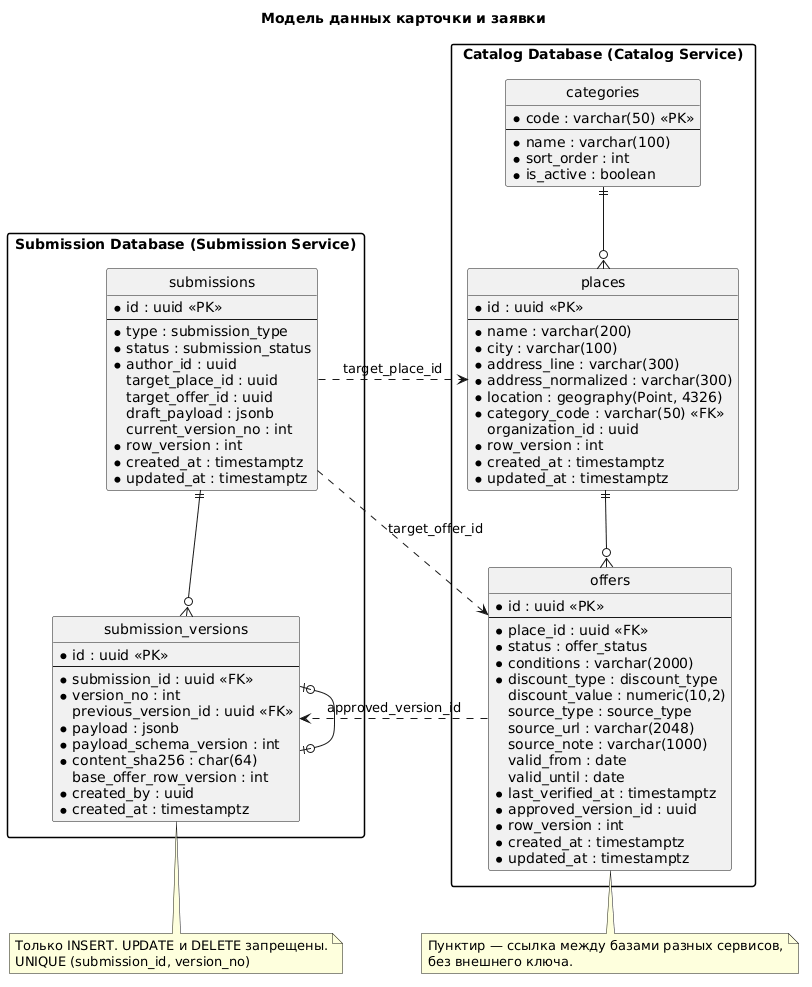

# Модель данных карточки и заявки

Документ описывает структуру карточки скидки, заявки и её версий, а также правила проверки обязательных полей. Он закрывает требования:

| ID | Требование | Issue |
|---|---|---|
| FR-013 | Карточка содержит название, адрес, координаты, категорию, условия, источник, дату проверки и срок действия | #6 |
| FR-021 | Обязательные поля: название, адрес, условия, категория, источник или подтверждение | #7 |
| FR-024 | Каждая заявка получает уникальный идентификатор и фиксированную версию данных | #8 |

Модерация, файлы, оценка риска и аудит описываются их владельцами. Здесь указано только, как они ссылаются на карточку и заявку.

---

## 1. Владельцы данных

| Сущность | Назначение | Сервис | База |
|---|---|---|---|
| `categories` | Справочник категорий | Catalog Service | Catalog Database |
| `places` | Физическое место: название, адрес, координаты, категория | Catalog Service | Catalog Database |
| `offers` | Предложение скидки: условия, источник, сроки, статус | Catalog Service | Catalog Database |
| `submissions` | Заявка: тип, автор, статус, черновик | Submission Service | Submission Database |
| `submission_versions` | Неизменяемые снимки отправленных данных | Submission Service | Submission Database |

Принцип из C4: у каждого сервиса своя база, изменять таблицы другого сервиса нельзя. Ссылки между базами хранятся как `uuid` без внешнего ключа, данные передаются через API и события.

---

## 2. Карточка (FR-013)

### 2.1. Место и предложение

Карточка, которую видит пользователь, состоит из двух сущностей: `places` и `offers`. Одно место может иметь несколько предложений (DESIGN §2.5), поэтому предложения нельзя хранить в строке места и нельзя объединять по совпадению адреса.

### 2.2. Поля карточки

| Поле FR-013 | Где хранится | Тип | Обязательно в карточке |
|---|---|---|---|
| Название | `places.name` | `varchar(200)` | Да |
| Адрес | `places.city`, `places.address_line` | `varchar(100)`, `varchar(300)` | Да |
| Координаты | `places.location` | `geography(Point, 4326)` | Да |
| Категория | `places.category_code` → `categories.code` | `varchar(50)` | Да |
| Условия | `offers.conditions`, `offers.discount_type`, `offers.discount_value` | `varchar(2000)`, enum, `numeric(10,2)` | Да, кроме `discount_value` |
| Источник | `offers.source_type`, `offers.source_url`, `offers.source_note` | enum, `varchar(2048)`, `varchar(1000)` | Да, если нет подтверждения |
| Дата проверки | `offers.last_verified_at` | `timestamptz` | Да |
| Срок действия | `offers.valid_from`, `offers.valid_until` | `date` | Нет, пустой `valid_until` — бессрочно |

Город вынесен в отдельное поле для фильтра по городу (FR-012). `address_normalized` заполняет сервис для поиска дубликатов (FR-017), пользователь его не передаёт.

`discount_type` не входит в FR-013, но нужен для поиска по типу скидки (FR-011) и для оценки риска («неясный размер скидки», DESIGN §2.4).

### 2.3. Таблица `places`

| Поле | Тип | Описание |
|---|---|---|
| `id` | `uuid` | Идентификатор места |
| `name` | `varchar(200)` | Название места |
| `city` | `varchar(100)` | Город |
| `address_line` | `varchar(300)` | Адрес без города в том виде, как его указал автор |
| `address_normalized` | `varchar(300)` | Нормализованный адрес для поиска дубликатов |
| `location` | `geography(Point, 4326)` | Координаты WGS 84, GIST-индекс |
| `category_code` | `varchar(50)` | Категория места |
| `organization_id` | `uuid` | Организация после верификации представителя (FR-045), может быть пустым |
| `row_version` | `int` | Версия строки для optimistic locking (NFR-018) |
| `created_at`, `updated_at` | `timestamptz` | Время в UTC |

### 2.4. Таблица `offers`

| Поле | Тип | Описание |
|---|---|---|
| `id` | `uuid` | Идентификатор предложения |
| `place_id` | `uuid` | Место |
| `status` | `offer_status` | `ACTIVE`, `EXPIRED`, `SUSPENDED`, `ARCHIVED` (DESIGN §2.2) |
| `conditions` | `varchar(2000)` | Условия скидки текстом |
| `discount_type` | `discount_type` | `PERCENT`, `FIXED_AMOUNT`, `SPECIAL_PRICE`, `FREE_ITEM`, `OTHER` |
| `discount_value` | `numeric(10,2)` | Размер скидки: процент или сумма |
| `source_type` | `source_type` | `WEBSITE`, `SOCIAL_MEDIA`, `ORGANIZATION`, `PERSONAL_VISIT`, `OTHER` |
| `source_url` | `varchar(2048)` | Ссылка на источник, только `http` и `https` |
| `source_note` | `varchar(1000)` | Описание источника без ссылки |
| `valid_from`, `valid_until` | `date` | Срок действия |
| `last_verified_at` | `timestamptz` | Последнее подтверждение актуальности: публикация или повторная проверка |
| `approved_version_id` | `uuid` | Версия заявки, из которой собрано текущее состояние |
| `row_version` | `int` | Версия строки для optimistic locking |
| `created_at`, `updated_at` | `timestamptz` | Время в UTC |

В публичную выдачу попадают только предложения со статусом `ACTIVE` (FR-016). Перевод в `EXPIRED` по `valid_until` выполняется по политике актуальности (FR-040).

### 2.5. Справочник `categories`

Категории хранятся в таблице, а не в enum: новую категорию можно добавить миграцией данных без изменения схемы и релиза сервисов. Категория относится к месту. Справочник одноуровневый; иерархия не нужна для MVP.

| Поле | Тип | Описание |
|---|---|---|
| `code` | `varchar(50)` | Код категории, например `cafe` |
| `name` | `varchar(100)` | Отображаемое название |
| `sort_order` | `int` | Порядок в фильтрах |
| `is_active` | `boolean` | Неактивную категорию нельзя выбрать в новой заявке |

---

## 3. Заявка и версии (FR-024)

### 3.1. Типы заявок

| Тип | Назначение | `target_place_id` | `target_offer_id` |
|---|---|---|---|
| `NEW_PLACE` | Новое место и первое предложение | — | — |
| `NEW_OFFER` | Новое предложение у существующего места | Заполнен | — |
| `CHANGE` | Изменение опубликованной карточки (FR-025) | Заполнен | Заполнен |

### 3.2. Таблица `submissions`

| Поле | Тип | Описание |
|---|---|---|
| `id` | `uuid` | Идентификатор заявки |
| `type` | `submission_type` | Тип из п. 3.1 |
| `status` | `submission_status` | Статус заявки (DESIGN §2.2) |
| `author_id` | `uuid` | Пользователь из Identity Service |
| `target_place_id`, `target_offer_id` | `uuid` | Изменяемые место и предложение |
| `draft_payload` | `jsonb` | Данные черновика, изменяются до отправки |
| `current_version_no` | `int` | Номер последней отправленной версии, пусто до первой отправки |
| `row_version` | `int` | Защита от конкурентного изменения статуса |
| `created_at`, `updated_at` | `timestamptz` | Время в UTC |

### 3.3. Таблица `submission_versions`

| Поле | Тип | Описание |
|---|---|---|
| `id` | `uuid` | Идентификатор версии |
| `submission_id` | `uuid` | Заявка |
| `version_no` | `int` | Номер версии внутри заявки, начиная с 1 |
| `previous_version_id` | `uuid` | Предыдущая версия, пусто для первой |
| `payload` | `jsonb` | Полный снимок данных карточки |
| `payload_schema_version` | `int` | Версия структуры `payload` |
| `content_sha256` | `char(64)` | Хэш нормализованного `payload` |
| `base_offer_row_version` | `int` | Для `CHANGE`: `offers.row_version`, от которой сделано изменение |
| `created_by` | `uuid` | Автор отправки |
| `created_at` | `timestamptz` | Время фиксации |

Ограничение: `UNIQUE (submission_id, version_no)`.

### 3.4. Идентификаторы

- Все идентификаторы — UUID версии 7. Их генерирует сервис; идентификатор, переданный клиентом, не принимается.
- UUIDv7 упорядочен по времени: вставка не фрагментирует индекс, курсорная пагинация может опираться на `id` (FR-015).
- Последовательные числовые идентификаторы наружу не отдаются, их перебор упрощает IDOR (NFR-017).

### 3.5. Правила версий

1. Черновик (`DRAFT`) хранится в `submissions.draft_payload` и изменяется на месте (FR-023). Версия не создаётся.
2. При отправке `payload` копируется в новую строку `submission_versions` с `version_no = 1`.
3. Повторная отправка после `CHANGES_REQUESTED` создаёт версию `N + 1` со ссылкой на предыдущую (DESIGN §6.3, п. 2).
4. Строки `submission_versions` не изменяются и не удаляются. Запрет закреплён триггером в базе, а не только кодом сервиса.
5. Решение модерации ссылается на пару `(submission_id, version_no)`. Одобрить можно только версию, которая была проверена (DESIGN §6.3, п. 3).
6. Создание версии, смена статуса заявки и запись события в outbox выполняются в одной транзакции (NFR-027).
7. Повторный запрос на отправку с тем же ключом идемпотентности не создаёт новую версию (FR-029). Если `content_sha256` совпадает с последней версией, новая версия тоже не создаётся, ответ содержит существующую.

### 3.6. Структура `payload`

`payload` содержит полное состояние карточки, а не разницу с опубликованной версией. Модератор видит разницу, которую вычисляет сервис (DESIGN §2.6, п. 1). Для `CHANGE` снимок собирается из опубликованной карточки и правок автора.

```json
{
  "place": {
    "id": null,
    "name": "Кофейня «Зерно»",
    "city": "Санкт-Петербург",
    "addressLine": "Кронверкский пр., 49",
    "location": { "lat": 59.957100, "lon": 30.308300 },
    "categoryCode": "cafe"
  },
  "offer": {
    "id": null,
    "conditions": "15% на напитки при предъявлении студенческого билета",
    "discountType": "PERCENT",
    "discountValue": 15,
    "source": {
      "type": "WEBSITE",
      "url": "https://example.com/students",
      "note": null
    },
    "validFrom": null,
    "validUntil": "2027-06-30"
  },
  "attachments": [
    { "mediaAssetId": "01929f3e-7c1a-7b2e-9d41-5f0c3a8e2b17", "purpose": "PROOF" }
  ]
}
```

Изменение структуры, несовместимое с прежней, увеличивает `payload_schema_version`. Старые версии не переписываются.

### 3.7. Публикация одобренной версии

На C4 Level 2 не показано, как одобренная версия попадает в Catalog Service. Предлагаемая последовательность:

1. Moderation Service одобряет версию и публикует событие `SubmissionApproved` с `submissionId`, `versionId`, `versionNo` и `payload`.
2. Catalog Service создаёт или обновляет `places` и `offers`, записывает `approved_version_id`, `last_verified_at` и статус `ACTIVE`.
3. Для `CHANGE` Catalog Service сравнивает `base_offer_row_version` с текущим `offers.row_version`. При расхождении карточку уже изменили после отправки заявки, поэтому изменение не применяется. Перехода для этого случая на диаграмме состояний нет (вопрос 7).
4. Catalog Service публикует `OfferPublished`, Submission Service переводит заявку в `PUBLISHED`.

---

## 4. Проверка обязательных полей (FR-021)

### 4.1. Когда выполняется проверка

| Действие | Что проверяется |
|---|---|
| Сохранение черновика | Типы, длины, диапазоны и форматы (FR-052). Обязательность не проверяется |
| Отправка (`DRAFT → SUBMITTED`, `CHANGES_REQUESTED → SUBMITTED`) | Всё выше и обязательные поля |
| Статус `VALIDATING` | Результат проверки файлов-подтверждений и координаты |

Черновик может быть неполным: пользователь заполняет его частями (FR-023). Отсутствие обязательных полей блокирует отправку независимо от оценки риска (DESIGN §2.4).

### 4.2. Правила полей

| Поле | Обязательно при отправке | Ограничения | Код ошибки |
|---|---|---|---|
| `place.name` | Да | 1–200 символов после удаления пробелов по краям | `REQUIRED`, `TOO_LONG` |
| `place.city` | Да | 1–100 символов | `REQUIRED`, `TOO_LONG` |
| `place.addressLine` | Да | 1–300 символов | `REQUIRED`, `TOO_LONG` |
| `place.categoryCode` | Да | Активная категория из справочника | `REQUIRED`, `UNKNOWN_CATEGORY` |
| `place.location` | Нет | Широта −90…90, долгота −180…180 | `OUT_OF_RANGE` |
| `offer.conditions` | Да | 1–2000 символов | `REQUIRED`, `TOO_LONG` |
| `offer.discountType` | Нет | Значение из перечня, по умолчанию `OTHER` | `INVALID_VALUE` |
| `offer.discountValue` | Нет | `PERCENT`: 1–100; `FIXED_AMOUNT`, `SPECIAL_PRICE`: больше 0 | `OUT_OF_RANGE` |
| `offer.source` или `attachments` с `purpose = PROOF` | Хотя бы одно | См. п. 4.3 | `SOURCE_OR_PROOF_REQUIRED` |
| `offer.source.url` | Нет | Схема `http` или `https`, до 2048 символов | `INVALID_FORMAT` |
| `offer.validFrom`, `offer.validUntil` | Нет | `validUntil` не раньше `validFrom` и не в прошлом | `DATE_RANGE_INVALID` |

Пустая строка и строка из пробелов считаются отсутствующим значением.

### 4.3. Источник или подтверждение

- Источник указан, если задан `source.type` и заполнено `source.url` или `source.note`.
- Подтверждение указано, если к заявке приложен хотя бы один файл с `purpose = PROOF`.
- При отправке файл засчитывается, даже если он ещё в карантине. Окончательно подтверждение проверяется в `VALIDATING`: если источника нет, а все файлы-подтверждения получили статус `REJECTED`, заявка переходит в `REJECTED` (переход «Некорректные данные / опасный файл» на диаграмме состояний C4).

### 4.4. Координаты

FR-021 не требует координат от автора, но карточка без них не может быть опубликована: `places.location` обязательно.

Рекомендуемый подход:

- автор может поставить точку на карте;
- если точки нет, в `VALIDATING` адрес передаётся геокодеру через адаптер (FR-056);
- если геокодер не нашёл адрес, заявка всё равно идёт в очередь, а модератор ставит точку до одобрения.

### 4.5. Заявки на изменение

Для `CHANGE` обязательные поля проверяются на итоговом снимке: опубликованная карточка вместе с правками автора. Если автор не менял адрес, повторно вводить его не нужно.

### 4.6. Формат ошибки

Ошибки возвращаются одним ответом со всеми найденными нарушениями. Ответ — HTTP `422` в формате `application/problem+json` (RFC 9457). Синтаксически некорректный JSON возвращает `400`.

```json
{
  "type": "about:blank",
  "title": "Заявка не прошла проверку",
  "status": 422,
  "submissionId": "01929f3d-2b6e-7a10-8c55-1e4f9b0d7a63",
  "errors": [
    { "field": "place.addressLine", "code": "REQUIRED", "message": "Укажите адрес" },
    { "field": "offer.source", "code": "SOURCE_OR_PROOF_REQUIRED", "message": "Укажите источник или приложите подтверждение" }
  ]
}
```

Поле `code` стабильно и используется frontend; `message` может меняться.

---

## 5. Диаграмма и схема БД



SQL-схема для PostgreSQL 17 и PostGIS 3.5, по файлу на базу: [catalog.sql](schema/catalog.sql), [submission.sql](schema/submission.sql). Это основа будущих миграций Flyway. Ограничения из разделов 2–4, которые можно проверить в базе, закреплены в ней: обязательные поля, диапазоны, соответствие типа заявки и целей, цепочка версий, запрет изменения версий.

<!--
@startuml ER_DataModel
title Модель данных карточки и заявки
hide circle
skinparam shadowing false
skinparam defaultFontName Helvetica
skinparam packageStyle rectangle

package "Catalog Database (Catalog Service)" {
  entity categories {
    * code : varchar(50) <<PK>>
    --
    * name : varchar(100)
    * sort_order : int
    * is_active : boolean
  }

  entity places {
    * id : uuid <<PK>>
    --
    * name : varchar(200)
    * city : varchar(100)
    * address_line : varchar(300)
    * address_normalized : varchar(300)
    * location : geography(Point, 4326)
    * category_code : varchar(50) <<FK>>
    organization_id : uuid
    * row_version : int
    * created_at : timestamptz
    * updated_at : timestamptz
  }

  entity offers {
    * id : uuid <<PK>>
    --
    * place_id : uuid <<FK>>
    * status : offer_status
    * conditions : varchar(2000)
    * discount_type : discount_type
    discount_value : numeric(10,2)
    source_type : source_type
    source_url : varchar(2048)
    source_note : varchar(1000)
    valid_from : date
    valid_until : date
    * last_verified_at : timestamptz
    * approved_version_id : uuid
    * row_version : int
    * created_at : timestamptz
    * updated_at : timestamptz
  }
}

package "Submission Database (Submission Service)" {
  entity submissions {
    * id : uuid <<PK>>
    --
    * type : submission_type
    * status : submission_status
    * author_id : uuid
    target_place_id : uuid
    target_offer_id : uuid
    draft_payload : jsonb
    current_version_no : int
    * row_version : int
    * created_at : timestamptz
    * updated_at : timestamptz
  }

  entity submission_versions {
    * id : uuid <<PK>>
    --
    * submission_id : uuid <<FK>>
    * version_no : int
    previous_version_id : uuid <<FK>>
    * payload : jsonb
    * payload_schema_version : int
    * content_sha256 : char(64)
    base_offer_row_version : int
    * created_by : uuid
    * created_at : timestamptz
  }
}

categories ||--o{ places
places ||--o{ offers
submissions ||--o{ submission_versions
submission_versions |o--o| submission_versions

offers ..> submission_versions : approved_version_id
submissions ..> places : target_place_id
submissions ..> offers : target_offer_id

note bottom of submission_versions
  Только INSERT. UPDATE и DELETE запрещены.
  UNIQUE (submission_id, version_no)
end note

note bottom of offers
  Пунктир — ссылка между базами разных сервисов,
  без внешнего ключа.
end note
@enduml
-->

---

## 6. Точки интеграции

| Задача | Исполнитель | Что использует из модели |
|---|---|---|
| FR-020 Создание заявки | @razuvaevlev | `submissions`, проверка из раздела 4, генерация версии |
| FR-025 Изменение карточки | @razuvaevlev | Тип `CHANGE`, полный снимок, `base_offer_row_version` |
| FR-016 Только одобренные версии | @razuvaevlev | `offers.status`, `approved_version_id`, `valid_until` |
| FR-012 Фильтр по радиусу и городу | @razuvaevlev | `places.location`, `places.city`, GIST-индекс |
| FR-010 Карта и список | @ArslanEfimov | Поля карточки из п. 2.2 |
| FR-011 Поиск | @ArslanEfimov | `name`, `address_line`, `category_code`, `discount_type` |
| FR-015 Пагинация | @ArslanEfimov | UUIDv7 как ключ курсора |
| FR-001, FR-002 Аутентификация и права | @ShulganRoman | `author_id`, проверка владельца заявки |

---

## 7. Открытые вопросы

| № | Вопрос | Предложение |
|---|---|---|
| 1 | Нужно ли предложению собственное название, кроме названия места? | Не вводить в MVP; карточку описывают название места и условия |
| 2 | Достаточно ли перечня `discount_type` и нужен ли он в заявке обязательно? | Перечень из п. 2.4, в заявке необязателен, модератор уточняет при проверке |
| 3 | Какой формат идентификатора пользователя отдаёт Identity Service? | `uuid` локального профиля, а не `sub` внешнего провайдера |
| 4 | Как Submission Service получает текущего пользователя и роль? | Из claims проверенного токена после API Gateway |
| 5 | Где хранится payload события `SubmissionApproved` в Schema Registry и в каком формате? | JSON Schema, версия схемы совпадает с `payload_schema_version` |
| 6 | Код сервисов в одном репозитории или в отдельных? | Решить до начала реализации, от этого зависит, где лежат общие DTO |
| 7 | Что происходит с одобренной заявкой `CHANGE`, если карточку изменили раньше её публикации? | Добавить переход `APPROVED → PENDING_REVIEW` с причиной «конфликт версий» |
