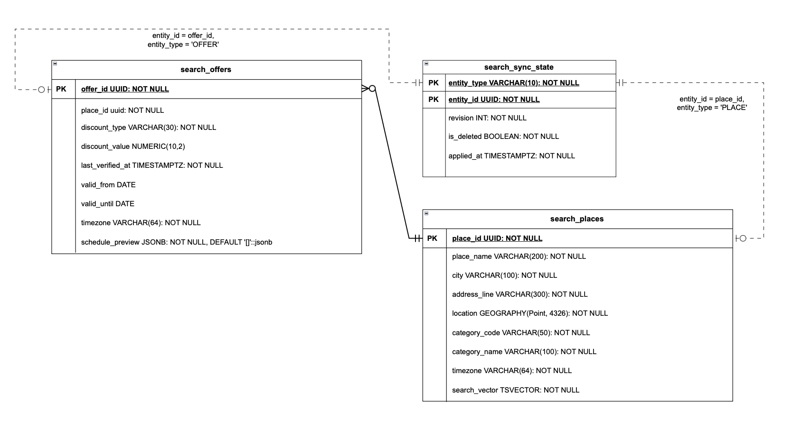

# Модель данных сервиса поиска

Документ описывает поисковую копию каталога: поля для поиска, фильтрации, карты и кратких карточек, а также состояние синхронизации с Catalog Service. Хранилище — PostgreSQL + PostGIS.

Catalog Service остаётся источником данных и выдаёт полную страницу места с предложениями. Search Service получает опубликованные данные через события и поддерживает собственную модель чтения. Данные места хранятся отдельно от предложений: в списке и на карте одна карточка соответствует одному месту по одному адресу.

Поля каталога основаны на [модели карточки и заявки](DATA-MODEL.md). Формат расписания для Search и правила версионирования событий требуют согласования с Catalog Service.

## 1. Основные таблицы

### 1.1. Поисковые места — `search_places`

Таблица хранит данные мест для текстового поиска, фильтрации и карты.

| Поле | Тип | Ограничения | Назначение |
|---|---|---|---|
| `place_id` | `uuid` | Первичный ключ, `NOT NULL`; идентификатор из Catalog | Место, которому соответствует поисковая запись |
| `place_name` | `varchar(200)` | `NOT NULL`; непустое значение после удаления пробелов по краям | Название места для поиска и карточки |
| `city` | `varchar(100)` | `NOT NULL`; непустое значение | Город для отдельного фильтра и отображения |
| `address_line` | `varchar(300)` | `NOT NULL`; непустое значение | Адрес места для поиска и карточки |
| `location` | `geography(Point, 4326)` | `NOT NULL`; координаты WGS 84, широта от −90 до 90, долгота от −180 до 180 | Геопоиск, область карты и вычисление расстояния |
| `category_code` | `varchar(50)` | `NOT NULL`; стабильный код категории Catalog в формате `^[a-z][a-z0-9_]*$` | Фильтрация по категории |
| `category_name` | `varchar(100)` | `NOT NULL`, как у `categories.name` в Catalog | Название категории для отображения |
| `timezone` | `varchar(64)` | `NOT NULL`; SQL проверяет формат как в Catalog: `^[A-Za-z]+(/[A-Za-z0-9_+-]+)+$` или `UTC`; существование идентификатора IANA проверяет consumer | Часовой пояс места для проверки сроков |
| `search_vector` | `tsvector` | `NOT NULL`; формируется локально из названия места и адреса | Подготовленное представление текста для полнотекстового поиска |

#### 1.1.1. Основные моменты

- **Единица хранения.** Одна запись — одно физическое место по одному адресу. При изменении названия или адреса обновляется одна строка места; данные предложений остаются отдельно.
- **Связь с предложениями.** Одному месту соответствует несколько строк `search_offers`. Связь внутри Search DB обеспечивается внешним ключом; внешних ключей в Catalog DB нет.
- **Выдача и пагинация.** Сначала выбираются места, у которых есть хотя бы одно предложение, подходящее по фильтрам и сроку действия. Пагинация выполняется по местам, затем загружаются предложения для превью.
- **Категории.** `category_code` — стабильное значение для фильтра API, `category_name` — отображаемое название. Например, `food` и «Еда».
- **Расстояние.** Вычисляется относительно точки пользователя; отдельным столбцом не хранится.
- **Сохранение строки.** Место сохраняется и при отсутствии активных предложений, но в выдачу не попадает. Последняя применённая версия места хранится в `search_sync_state`.
- **Ограничения.** Проверки названия, города, адреса, формата часового пояса и кода категории совпадают с SQL Catalog. Корректность координат и существование часового пояса IANA проверяет consumer.

**Текстовый поиск — `search_vector`**

| Исходные поля | Вес | Назначение |
|---|---|---|
| `place_name` | `A` | Наибольший приоритет совпадений в названии места |
| `address_line` | `B` | Поиск по адресу |

- **Формирование.** PostgreSQL автоматически строит и обновляет вектор в вычисляемом хранимом столбце (`GENERATED ALWAYS AS ... STORED`) с помощью `to_tsvector` и весов. Вектор хранится один раз на место; при записи Search не задаёт его вручную.
- **Сопоставление.** Текстовый поиск выполняется только по названию места и адресу. Город и категория применяются отдельными фильтрами по `city` и `category_code`; город в `search_vector` не включается.
- **Индексы.** В `search_places` предусмотрены GIN по `search_vector` и GiST по `location`. В `search_offers` сохранён индекс по `place_id` для получения предложений места.

SQL использует конфигурацию `pg_catalog.russian`; её же нужно указывать при построении поискового запроса.

### 1.2. Поисковые предложения — `search_offers`

Таблица хранит все предложения со статусом `ACTIVE` по последнему применённому событию Catalog. Общие данные места получаются через связь с `search_places`.

| Поле | Тип | Ограничения | Назначение |
|---|---|---|---|
| `offer_id` | `uuid` | Первичный ключ, `NOT NULL`; идентификатор из Catalog | Предложение, которому соответствует поисковая запись |
| `place_id` | `uuid` | `NOT NULL`; внешний ключ на `search_places.place_id`; не уникален | Связь предложения с местом |
| `discount_type` | `discount_type` (ENUM) | `NOT NULL`, по умолчанию `OTHER`; значения как в Catalog: `PERCENT`, `FIXED_AMOUNT`, `SPECIAL_PRICE`, `FREE_ITEM`, `OTHER` | Интерпретация размера скидки и фильтрация |
| `discount_value` | `numeric(10,2)` | Как в Catalog: `NULL` допустим для любого типа; заданное значение для `PERCENT` — больше 0 и не больше 100, для `FIXED_AMOUNT` и `SPECIAL_PRICE` — больше 0; для остальных типов — только `NULL` | Процент, сумма скидки или специальная цена |
| `last_verified_at` | `timestamptz` | `NOT NULL`; передаётся Catalog | Дата последнего подтверждения актуальности |
| `valid_from` | `date` | Допускает `NULL`; если задано, предложение не включается в выдачу раньше этой даты | Начало общего периода действия |
| `valid_until` | `date` | Допускает `NULL`; при заданных обеих датах не раньше `valid_from` | Последний день общего периода действия включительно |
| `schedule_preview` | `jsonb` | `NOT NULL`, по умолчанию `[]`; массив групп дней и временных интервалов, правила ниже | Полное структурированное расписание предложения |

#### 1.2.1. Основные моменты

- **Единица хранения.** Одна запись — одно предложение; несколько предложений могут ссылаться на один `place_id`.
- **Краткая карточка.** Название, категория и адрес берутся из `search_places`, выгода, расписание и даты — из `search_offers`. Условия и отдельное краткое описание акции в выдаче не отображаются. Полная страница места открывается через Catalog.
- **Выбор предложений.** Для превью выбираются до двух предложений, подходящих по фильтрам и общему сроку действия: сначала недавно проверенные (`last_verified_at DESC`), при равенстве — по `offer_id ASC`. Текстовый запрос ищет место и не меняет порядок его предложений.
- **Активность.** Столбца `status` нет: при событии о неактивном предложении запись удаляется. Дополнительно каждый поисковый запрос проверяет общий срок действия.
- **Даты и часовой пояс.** Сравнение выполняется с текущей датой места в `search_places.timezone`; день `valid_until` включён в срок. `NULL` означает отсутствие соответствующей границы. Это исключает будущие и истёкшие предложения даже при задержке смены статуса.
- **Удаление из поиска.** При снятии предложения с публикации удаляется только строка `search_offers`; строка места и состояние синхронизации сохраняются. Проверки типа и значения скидки, порядка дат совпадают с SQL Catalog.
- **Данные полной карточки.** Полные условия `conditions` остаются в Catalog и не входят в поисковую запись или контракт событий для Search. Источник предложения, закрытый `source_note`, связи с заявками и модерацией, `organization_id` и служебные даты строк Catalog в Search также не копируются.

**Расписание — `schedule_preview`**

Дни с одинаковым набором интервалов объединяются в группу. В поисковой записи сохраняются все группы расписания; сокращение количества видимых строк выполняет frontend.

```json
[
  {
    "daysOfWeek": [1, 2, 3, 4, 5],
    "intervals": [
      { "timeFrom": "10:00", "timeUntil": "14:00" }
    ]
  },
  {
    "daysOfWeek": [6, 7],
    "intervals": [
      { "timeFrom": "15:00", "timeUntil": "19:00" }
    ]
  }
]
```

| Элемент | Ограничения |
|---|---|
| `daysOfWeek` | Непустой массив уникальных чисел от 1 до 7: понедельник — 1, воскресенье — 7. Один день не повторяется в разных группах |
| `intervals` | Непустой массив интервалов, применяемых к каждому дню группы; интервалы упорядочены по началу и не пересекаются |
| `timeFrom`, `timeUntil` | Строки в формате `HH:mm`, время местное; начало строго раньше конца. `24:00` допускается только как конец интервала |
| Границы интервала | Начало включительно, конец исключительно: `[timeFrom, timeUntil)`. Соседние интервалы могут стыковаться |
| Переход через полночь | Разделяется на интервалы двух дней, например пятница 22:00–24:00 и суббота 00:00–02:00 |
| Размер расписания | После разворачивания групп по дням — не больше 28 интервалов, как в модели Catalog |
| Пустой массив `[]` | Дополнительных ограничений по дням и часам нет; общий срок предложения всё равно проверяется |

- **Формирование.** Предлагается собирать группы в Catalog из `offer_schedule` и передавать в событии. Идентификаторы интервалов не копируются.
- **Проверка.** SQL проверяет, что `schedule_preview` — массив. Consumer проверяет структуру и ограничения до применения события; тип `jsonb` сам по себе не проверяет дни недели, пересечения и допустимость времени.
- **Отображение.** Frontend формирует подписи из дней и интервалов, например «Будни: 10:00–14:00», без разбора готовой текстовой строки.
- **«Действует сейчас».** Фильтр пока не согласован. Для него нужно проверять день и время по расписанию в часовом поясе места; наличия записи в Search недостаточно.

### 1.3. Состояние синхронизации — `search_sync_state`

Таблица хранит последние применённые версии мест и предложений, включая предложения, удалённые из поисковой выдачи.

| Поле | Тип | Ограничения | Назначение |
|---|---|---|---|
| `entity_type` | `varchar(10)` | `NOT NULL`; `PLACE` или `OFFER`; часть составного первичного ключа | Тип синхронизируемой сущности |
| `entity_id` | `uuid` | `NOT NULL`; часть составного первичного ключа; идентификатор из Catalog | `place_id` для места или `offer_id` для предложения |
| `revision` | `int` | `NOT NULL`, не меньше 0; сохраняется только более новая версия | Последняя применённая версия этой сущности из Catalog |
| `is_deleted` | `boolean` | `NOT NULL`; после commit значение согласовано с наличием соответствующей записи | Для предложения: `true` — удалено из `search_offers`, `false` — сохранено. Для сохраняемых мест — `false` |
| `applied_at` | `timestamptz` | `NOT NULL`; заполняет Search при успешном применении изменения | Время применения последней версии |

#### 1.3.1. Основные моменты

- **Общий ключ.** Состояние определяется парой `(entity_type, entity_id)`. Версии места и предложения независимы; в `search_places` и `search_offers` они не дублируются.
- **Сохранение состояния.** При удалении предложения из поиска строка состояния остаётся с `is_deleted = true`. Повторная доставка старого события не восстановит скрытое предложение; более новая версия `ACTIVE` может его восстановить.
- **Связь таблиц.** Внешних ключей на `search_places` и `search_offers` нет: состояние должно сохраняться независимо от наличия строки данных. Флаг удаления относится только к поисковой копии, а не к Catalog.

### 1.4. Схема БД



## 2. Основные правила синхронизации

- **События.** Данные места передаются в `PlaceChanged`, данные предложения — в `OfferChanged`. Контракт необходимо привести к этому разделению.
- **Версии.** `revision` сохраняется в `search_sync_state` отдельно для каждой пары `(entity_type, entity_id)`. Search не увеличивает версию самостоятельно.
- **Источник версии.** Счётчики поддерживает Catalog. `row_version` подходит, только если увеличивается при любом изменении снимка, включая расписание предложения и название категории места; иначе нужен отдельный `event_revision` для каждой сущности.

| Условие или операция | Правило |
|---|---|
| Состояния сущности ещё нет | Применить первую полученную версию, включая 0 |
| Входящая версия ≤ сохранённой для той же сущности | Пропустить событие без изменения данных и состояния |
| Первая или более новая версия места | Создать или обновить `search_places`; сохранить версию с типом `PLACE` и `is_deleted = false` |
| Более новая версия предложения, `ACTIVE` | Создать или обновить `search_offers`; сохранить версию и `is_deleted = false` |
| Место для активного предложения ещё не получено | Надёжно отложить событие до получения места; не отмечать его применённым |
| Более новая версия предложения, `SUSPENDED`, `EXPIRED`, `ARCHIVED` | Удалить строку `search_offers`; сохранить версию и `is_deleted = true` |
| Запись в Search DB | Проверить версию и записать данные вместе с `search_sync_state` одной транзакцией с защитой от конкурентной обработки; подтвердить обработку в Kafka после commit |
| Изменение данных места | Обновить одну строку `search_places`; обновление строк `search_offers` ради названия, адреса и других полей места не требуется |
| Изменение названия категории | Catalog передаёт обновлённые снимки затронутых мест с новыми версиями; массовая обработка выполняется порциями |
| Закрытие места | Catalog изменяет статусы затронутых предложений и передаёт события; Search удаляет предложения из `search_offers` |

