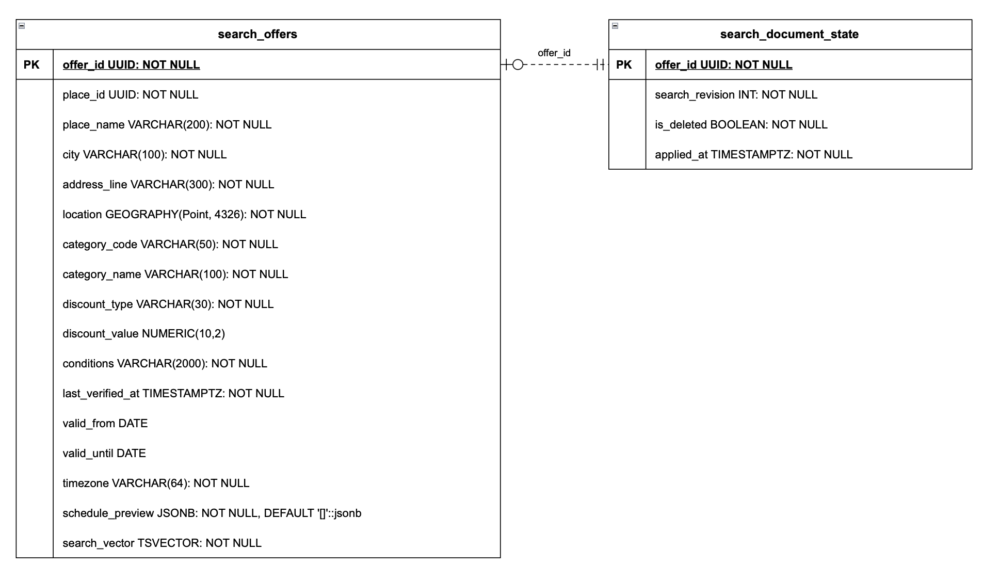

# Модель данных сервиса поиска

Документ описывает поисковую копию каталога: поля для поиска, фильтрации, карты и кратких карточек, а также состояние синхронизации с Catalog Service. Хранилище — PostgreSQL + PostGIS.

Catalog Service остаётся источником данных и выдаёт полную карточку предложения. Search Service получает опубликованные данные через события и поддерживает собственную модель чтения. Одна поисковая запись соответствует одному предложению; для списка и карты несколько предложений могут объединяться по месту.

Поля каталога основаны на [модели карточки и заявки](DATA-MODEL.md). Формат расписания для Search и правила версионирования событий требуют согласования с Catalog Service.

## 1. Основные таблицы

### 1.1. Поисковые предложения — `search_offers`

Таблица хранит предложения со статусом `ACTIVE` по последнему применённому событию Catalog. Данные используются для поиска и отображения краткой карточки в выдаче.

| Поле | Тип | Ограничения | Назначение |
|---|---|---|---|
| `offer_id` | `uuid` | Первичный ключ, `NOT NULL`; идентификатор из Catalog | Предложение, которому соответствует поисковая запись |
| `place_id` | `uuid` | `NOT NULL`; идентификатор из Catalog | Связь с местом и группировка предложений |
| `place_name` | `varchar(200)` | `NOT NULL`; непустое значение после удаления пробелов по краям | Название места для поиска и карточки |
| `city` | `varchar(100)` | `NOT NULL`; непустое значение | Город для фильтрации, поиска и отображения |
| `address_line` | `varchar(300)` | `NOT NULL`; непустое значение | Адрес места для поиска и карточки |
| `location` | `geography(Point, 4326)` | `NOT NULL`; координаты WGS 84, широта от −90 до 90, долгота от −180 до 180 | Геопоиск, область карты и вычисление расстояния |
| `category_code` | `varchar(50)` | `NOT NULL`; стабильный код категории Catalog в формате `^[a-z][a-z0-9_]*$` | Фильтрация по категории |
| `category_name` | `varchar(100)` | `NOT NULL`; непустое значение | Название категории для отображения |
| `discount_type` | `varchar(30)` | `NOT NULL`; одно из значений: `PERCENT`, `FIXED_AMOUNT`, `SPECIAL_PRICE`, `FREE_ITEM`, `OTHER` | Интерпретация размера скидки и фильтрация |
| `discount_value` | `numeric(10,2)` | Допускает `NULL`; для `PERCENT` — больше 0 и не больше 100; для `FIXED_AMOUNT` и `SPECIAL_PRICE` — больше 0; для остальных типов — `NULL` | Процент, сумма скидки или специальная цена |
| `conditions` | `varchar(2000)` | `NOT NULL`; непустое значение; исходный текст не обрезается при сохранении | Условия предложения для текстового поиска и превью |
| `last_verified_at` | `timestamptz` | `NOT NULL`; передаётся Catalog | Дата последнего подтверждения актуальности |
| `valid_from` | `date` | Допускает `NULL`; если задано, предложение не включается в выдачу раньше этой даты | Начало общего периода действия |
| `valid_until` | `date` | Допускает `NULL`; при заданных обеих датах не раньше `valid_from` | Последний день общего периода действия включительно |
| `timezone` | `varchar(64)` | `NOT NULL`; корректный идентификатор IANA, например `Europe/Moscow` | Часовой пояс места для проверки сроков |
| `schedule_preview` | `jsonb` | `NOT NULL`, по умолчанию `[]`; массив групп дней и временных интервалов, правила ниже | Структурированное расписание для карточки списка |
| `search_vector` | `tsvector` | `NOT NULL`; формируется локально из текстовых полей | Подготовленное представление текста для полнотекстового поиска |

#### 1.1.1. Основные моменты

- **Единица хранения.** Одна запись — одно предложение. В списке и на карте предложения группируются по `place_id`; пагинация карточек мест выполняется по местам.
- **Идентификаторы.** `offer_id` и `place_id` приходят из Catalog. Внешних ключей между БД сервисов нет; нужные поля места и категории включены в поисковую запись.
- **Категории.** `category_code` — стабильное значение для фильтра API, `category_name` — отображаемое название. Например, `food` и «Еда».
- **Краткая карточка.** Показываются название, категория, адрес, скидка, превью условий, расписание, дата проверки и при наличии дата окончания. Полная карточка открывается через Catalog. Текст `conditions` сохраняется целиком, а frontend ограничивает число видимых строк.
- **Расстояние.** Вычисляется относительно точки пользователя; отдельным столбцом не хранится.
- **Активность.** Столбца `status` нет: при событии о неактивном предложении запись удаляется. Дополнительно каждый поисковый запрос проверяет общий срок действия.
- **Даты и часовой пояс.** Сравнение выполняется с текущей датой места в `timezone`; день `valid_until` включён в срок. `NULL` означает отсутствие соответствующей границы. Это исключает будущие и истёкшие предложения даже при задержке смены статуса.
- **Данные полной карточки.** Источник предложения, закрытый `source_note`, связи с заявками и модерацией, `organization_id` и служебные даты строк Catalog в Search не копируются.

**Расписание — `schedule_preview`**

Дни с одинаковым набором интервалов объединяются в группу. В поисковой записи сохраняются все группы расписания; сокращение количества видимых строк выполняет frontend.

```json
[
  {
    "daysOfWeek": [1, 2, 3, 4, 5],
    "intervals": [
      { "timeFrom": "10:00", "timeUntil": "14:00" }
    ]
  },
  {
    "daysOfWeek": [6, 7],
    "intervals": [
      { "timeFrom": "15:00", "timeUntil": "19:00" }
    ]
  }
]
```

| Элемент | Ограничения |
|---|---|
| `daysOfWeek` | Непустой массив уникальных чисел от 1 до 7: понедельник — 1, воскресенье — 7. Один день не повторяется в разных группах |
| `intervals` | Непустой массив интервалов, применяемых к каждому дню группы; интервалы упорядочены по началу и не пересекаются |
| `timeFrom`, `timeUntil` | Строки в формате `HH:mm`, время местное; начало строго раньше конца. `24:00` допускается только как конец интервала |
| Границы интервала | Начало включительно, конец исключительно: `[timeFrom, timeUntil)`. Соседние интервалы могут стыковаться |
| Переход через полночь | Разделяется на интервалы двух дней, например пятница 22:00–24:00 и суббота 00:00–02:00 |
| Размер расписания | После разворачивания групп по дням — не больше 28 интервалов, как в модели Catalog |
| Пустой массив `[]` | Дополнительных ограничений по дням и часам нет; общий срок предложения всё равно проверяется |

- **Формирование.** Предлагается собирать группы в Catalog из `offer_schedule` и передавать в событии. Идентификаторы интервалов не копируются.
- **Проверка.** Consumer проверяет структуру и ограничения до применения события; тип `jsonb` сам по себе не проверяет дни недели, пересечения и допустимость времени.
- **Отображение.** Frontend формирует подписи из дней и интервалов, например «Будни: 10:00–14:00», без разбора готовой текстовой строки.
- **«Действует сейчас».** Фильтр пока не согласован. Для него нужно проверять день и время по расписанию в часовом поясе места; наличия записи в Search недостаточно.

**Текстовый поиск — `search_vector`**

| Исходные поля | Вес | Назначение |
|---|---|---|
| `place_name` | `A` | Наибольший приоритет совпадений в названии места |
| `conditions` | `B` | Поиск конкретных предложений, например по словам «маникюр» или «напитки» |
| `city`, `address_line` | `C` | Поиск по городу и адресу |

- **Формирование.** PostgreSQL автоматически строит и обновляет вектор в вычисляемом хранимом столбце (`GENERATED ALWAYS AS ... STORED`) с помощью `to_tsvector` и весов. В событии Catalog передаёт текстовые поля; при записи Search не задаёт `search_vector` вручную.
- **Сопоставление.** Конфигурация обработки текста и запроса должна совпадать. Категория применяется отдельным фильтром по `category_code`.
- **Индексы.** Для полнотекстового поиска планируется GIN по `search_vector`, для геопоиска — GiST по `location`.

SQL использует конфигурацию `pg_catalog.russian`; её же нужно указывать при построении поискового запроса. В БД проверяется, что `schedule_preview` — массив. Полную структуру расписания, корректность часового пояса IANA и исходных координат проверяет consumer до сохранения.

### 1.2. Состояние поискового документа — `search_document_state`

Таблица хранит последнюю применённую версию каждого предложения, включая предложения, удалённые из поисковой выдачи.

| Поле | Тип | Ограничения | Назначение |
|---|---|---|---|
| `offer_id` | `uuid` | Первичный ключ, `NOT NULL`; идентификатор из Catalog | Предложение, к которому относится состояние |
| `search_revision` | `int` | `NOT NULL`, не меньше 0; сохраняется только более новая версия | Последняя применённая версия данных из Catalog |
| `is_deleted` | `boolean` | `NOT NULL`; после commit значение согласовано с наличием поискового документа | `true` — документ намеренно удалён из `search_offers`; `false` — документ сохранён |
| `applied_at` | `timestamptz` | `NOT NULL`; заполняет Search при успешном применении изменения | Время применения последней версии |

#### 1.2.1. Основные моменты

- **Сохранение состояния.** Строка остаётся после удаления документа. Это не позволяет старому событию восстановить скрытое предложение.
- **Версия.** После применения версии 6 события версий 6 и ниже не изменяют данные. Более новая версия может восстановить активное предложение.
- **Флаг удаления.** `is_deleted = true` означает отсутствие документа в поисковой копии. Предложение при этом может оставаться в Catalog.
- **Связь таблиц.** Используется одинаковый `offer_id`. Внешнего ключа из состояния на `search_offers` нет: строка состояния допустима без поискового документа.

### 1.3. Схема БД



Пунктир обозначает логическую связь по `offer_id`, без внешнего ключа: одному состоянию соответствует ноль или один поисковый документ.

## 2. Основные правила синхронизации

В качестве `search_revision` предлагается `offers.row_version`. Catalog должен увеличивать её при каждом изменении данных поискового документа, включая место, расписание и название категории. Это правило требует согласования; версия должна соответствовать переданному снимку.

| Условие или операция | Правило |
|---|---|
| Событие Catalog | Для `ACTIVE` передаётся полный актуальный снимок поисковых данных. Для скрытия или удаления достаточно идентификатора, состояния и версии |
| Состояния ещё нет | Применить первую полученную версию, включая 0 |
| Входящая версия ≤ сохранённой | Не изменять поисковый документ и сохранённое состояние |
| Более новая версия, `ACTIVE` | Создать или заменить документ; сохранить версию и `is_deleted = false` |
| Более новая версия, `SUSPENDED`, `EXPIRED`, `ARCHIVED` или удаление | Удалить документ; сохранить версию и `is_deleted = true` |
| Запись в Search DB | Проверить версию и изменить обе таблицы одной транзакцией с защитой от конкурентной обработки; подтвердить сообщение Kafka после commit |
| Изменение или закрытие места | Catalog отправляет обновления всех затронутых предложений; закрытое место исключается из поиска через удаление его предложений |

