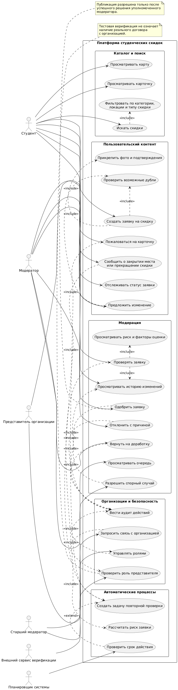
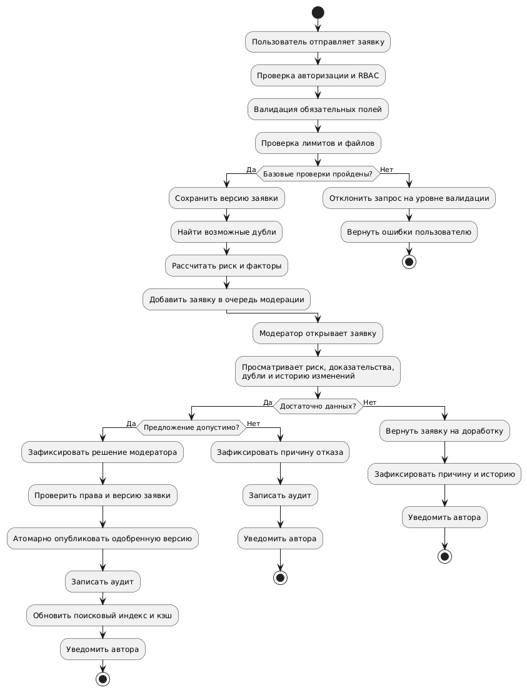

# Карта студенческих скидок: требования и проектирование

## 1. Цель и границы проекта

Создать UGC-платформу (user-generated content), на которой студенты находят места со скидками, добавляют предложения и фотографии, а представители организаций после тестовой верификации могут предлагать изменения карточек.

Ключевой принцип: **любое новое предложение и любое существенное изменение проходят премодерацию**. Автоматическая оценка помогает выявлять риски, искать дубликаты и расставлять приоритеты, но сама по себе не разрешает публикацию.

### 1.1. Масштаб

- Зарегистрированные студенты: **1 000 000**.
- Целевая пиковая нагрузка: **около 10 000 RPS**.
- 10 000 RPS — это нагрузка на систему, а не количество активных пользователей.
- Нагрузка должна быть определена профилем запросов: чтение каталога, поиск, получение карты, запись заявок, жалобы, загрузка файлов и административные операции.

### 1.2. В MVP входят

- Карта и каталог опубликованных скидок.
- Поиск по названию, категории, локации и типу скидки.
- Карточка места и предложения: адрес, условия, источник, дата проверки и срок действия.
- Регистрация и аутентификация.
- Роли студента, модератора, старшего модератора и представителя организации.
- Создание заявок на добавление места, скидки и изменение существующих карточек.
- Загрузка фотографий и подтверждений.
- Премодерация, автоматический скоринг риска и история решений.
- Поиск возможных дубликатов.
- Жалобы на неактуальные сведения, прекращение скидки или закрытие места.
- RBAC на backend, безопасная обработка файлов, rate limiting и аудит.
- Синтетические данные, автоматические тесты и воспроизводимый локальный запуск.

### 1.3. Не входит в обязательный MVP

- Платежи и реальные договоры с организациями.
- Коммерческое продвижение и полноценный B2B-кабинет.
- Персональные рекомендации и сложная ML-модель репутации.
- Полностью автоматическое одобрение предложений.

Эти функции можно добавлять после подтверждения качества каталога, модерации и антифрод-механизмов.

---

## 2. Модель модерации

### 2.1. Жизненный цикл заявки

1. Пользователь создаёт черновик.
2. Backend проверяет права, обязательные поля, лимиты и файлы.
3. Система сохраняет версию заявки, ищет возможные дубликаты и вычисляет риск.
4. Заявка поступает в очередь ручной премодерации.
5. Модератор изучает условия, адрес, источник, вложения, совпадения и историю.
6. Модератор принимает одно из решений:
   - одобрить;
   - отклонить с обязательной причиной;
   - вернуть на доработку;
   - запросить дополнительные подтверждения;
   - передать спорный случай старшему модератору.
7. При одобрении публикуется проверенная версия карточки.
8. Решение, автор решения, время, версия заявки и причина сохраняются в аудите.

**Автоматический скоринг не заменяет ручное решение.** Даже заявка с низким риском не публикуется без одобрения модератора.

### 2.2. Разделение статусов

Необходимо различать статус заявки, статус карточки и статус файла.

Статусы заявки:

- `DRAFT` — черновик;
- `SUBMITTED` — отправлена;
- `VALIDATING` — синтаксическая и файловая проверка;
- `CANCELLED` — отменена пользователем;
- `REJECTED` — отклонена (некорректные данные, опасный файл или отказ модератора);
- `PENDING_REVIEW` — проверки пройдены, ожидает назначения модератора;
- `IN_REVIEW` — на проверке у модератора;
- `CHANGES_REQUESTED` — требуются исправления;
- `APPROVED` — одобрена модератором;
- `PUBLISHED` — публикация подтверждена;
- `SUSPENDED` — приостановлена (жалоба, подозрение на нарушение или истечение срока);
- `ARCHIVED` — архивирована (скидка больше не действует или публикация снята).

Статусы предложения:

- `ACTIVE` — актуально и опубликовано;
- `EXPIRED` — срок действия истёк;
- `SUSPENDED` — временно скрыто;
- `ARCHIVED` — архивировано.

Статусы файла:

- `QUARANTINED` — в карантине;
- `PROCESSING` — обрабатывается;
- `CLEAN` — проверен;
- `REJECTED` — отклонён.

### 2.3. Изменения опубликованных карточек

Изменение опубликованной карточки оформляется отдельной заявкой и новой версией.

- Пока изменение проверяется, предыдущая одобренная версия остаётся публичной.
- При серьёзной жалобе или подтверждённом риске карточка может быть временно скрыта по заданным правилам.
- Обычная жалоба сама по себе не приводит к окончательному удалению карточки.
- Все решения и версии сохраняются; история не переписывается задним числом.

### 2.4. Автоматическая оценка риска

На первом этапе используется объяснимый скоринг от 0 до 100. Чем выше балл, тем выше приоритет и глубина ручной проверки. **Балл не является вероятностью мошенничества или доказательством нарушения.**

| Фактор | Максимальный вклад | Примеры |
|---|---:|---|
| Возможные дубликаты | 25 | Совпадение адреса, координат, названия или контактов |
| Достоверность условий | 20 | Противоречивые условия, неясный размер скидки |
| Подтверждения | 20 | Отсутствие источника, подозрительное изображение |
| История автора | 15 | Подтверждённые нарушения, массовые заявки |
| Актуальность | 10 | Истёкшая дата или конфликт сроков |
| Поведенческие аномалии | 10 | Всплески отправок, повторяющиеся шаблоны |

Это стартовые коэффициенты. Их нужно откалибровать на размеченном тестовом наборе.

#### Пороги обработки

| Риск | Действие |
|---|---|
| 0–29: низкий | Обычная очередь; модератор проверяет условия, адрес и подтверждения |
| 30–59: средний | Расширенная проверка совпадений, истории и доказательств |
| 60–100: высокий | Приоритетная ручная проверка и при необходимости эскалация |

Отдельные проверки не должны зависеть от скоринга. Например, недопустимый тип файла, отсутствие обязательных полей или превышение лимита блокируют обработку до исправления.

### 2.5. Поиск дубликатов

Проверка дубликатов должна разделять два вопроса:

1. Совпадает ли физическое место?
2. Совпадает ли конкретное предложение?

У одного заведения могут быть несколько разных скидок. Поэтому нельзя автоматически объединять предложения только из-за совпадения адреса.

Рекомендуемый подход:

- нормализация названия и адреса;
- точные совпадения контактных данных;
- географическое расстояние между координатами;
- нечёткое сравнение названий;
- сравнение описаний условий;
- показ модератору списка кандидатов, а не безусловное объединение.

### 2.6. Интерфейс модератора

Модератор должен видеть:

1. Новые значения и предыдущую версию карточки.
2. Балл риска, факторы оценки и сработавшие правила.
3. Возможные дубликаты в каталоге и на карте.
4. Фотографии и подтверждения в безопасном предпросмотре.
5. Историю заявок автора в пределах своих полномочий.
6. Жалобы, источник и срок действия предложения.
7. Действия: одобрить, отклонить с причиной, вернуть на доработку, запросить подтверждение или эскалировать.

При отклонении причина обязательна. Исправление ранее принятого решения оформляется новым событием аудита.

---

## 3. Функциональные требования

Приоритеты:

- **P0** — обязательно для MVP.
- **P1** — следующий этап.
- **P2** — дальнейшее развитие.

### 3.1. Пользователи и роли

| ID | Требование | Приоритет |
|---|---|---|
| FR-001 | Регистрация, вход, выход и завершение сессии | P0 |
| FR-002 | Backend проверяет права при каждом защищённом действии | P0 |
| FR-003 | Поддерживаются роли студента, модератора, старшего модератора и представителя организации | P0 |
| FR-004 | Пользователь управляет своими черновиками и отслеживает статусы заявок | P0 |
| FR-005 | Представитель получает права только после тестовой верификации связи с организацией | P0 |
| FR-006 | Модератор выполняет действия только в пределах выданных полномочий | P0 |
| FR-007 | Возможны блокировка аккаунта и ограничения операций при злоупотреблениях | P0 |
| FR-008 | Сохраняется история назначения, изменения и отзыва ролей | P0 |
| FR-009 | Возможна интеграция с внешним сервисом подтверждения статуса студента через адаптер | P1 |

RBAC учитывает не только роль, но и контекст ресурса. Представитель может предложить изменение карточки своей организации, но не может одобрить собственную заявку.

### 3.2. Карта, каталог и поиск

| ID | Требование | Приоритет |
|---|---|---|
| FR-010 | Просмотр опубликованных карточек на карте и в списке | P0 |
| FR-011 | Поиск по названию, категории, адресу и типу скидки | P0 |
| FR-012 | Фильтрация по радиусу, городу и географической области | P0 |
| FR-013 | Карточка содержит название, адрес, координаты, категорию, условия, источник, дату проверки и срок действия | P0 |
| FR-014 | Просмотр подробностей и переход к адресу или маршруту | P0 |
| FR-015 | Пагинация или курсорная выдача, сортировка и ограничение размера ответа | P0 |
| FR-016 | Публично доступны только одобренные версии, которые не скрыты и не признаны неактуальными | P0 |
| FR-017 | Поиск возможных дубликатов до создания новой самостоятельной карточки | P0 |
| FR-018 | Определённая политика обработки истёкших, скрытых и архивных предложений в поиске | P0 |
| FR-019 | Персональные рекомендации и скидки поблизости | P2 |

Карта должна ограничивать размер области и количество объектов. При большом масштабе следует использовать кластеризацию маркеров и серверные географические выборки.

### 3.3. Пользовательский контент

| ID | Требование | Приоритет |
|---|---|---|
| FR-020 | Создание заявки на добавление места и скидки | P0 |
| FR-021 | Обязательные поля: название, адрес, условия, категория, источник или подтверждение | P0 |
| FR-022 | Прикрепление фотографий и подтверждений в установленных лимитах | P0 |
| FR-023 | Редактирование черновика до отправки | P0 |
| FR-024 | Каждая заявка получает уникальный идентификатор и фиксированную версию данных | P0 |
| FR-025 | Изменение опубликованной карточки создаётся как новая заявка на версию | P0 |
| FR-026 | Поддерживаются срок действия скидки и дата последней проверки | P0 |
| FR-027 | Пользователь может сообщить о прекращении скидки или закрытии места | P0 |
| FR-028 | Жалоба содержит категорию и описание причины | P0 |
| FR-029 | Идемпотентные операции не создают дубликаты при повторной отправке запроса | P0 |
| FR-030 | Подтверждение актуальности сообществом и учёт таких сигналов в риск-модели | P1 |

### 3.4. Модерация и доверие

| ID | Требование | Приоритет |
|---|---|---|
| FR-031 | Каждая новая карточка и каждое существенное изменение проходят премодерацию | P0 |
| FR-032 | Предложение не публикуется до одобрения | P0 |
| FR-033 | Автоматический оценщик возвращает риск и объясняющие факторы | P0 |
| FR-034 | Модератор видит очередь, приоритет, риск и историю изменений | P0 |
| FR-035 | Модератор может одобрить, отклонить или вернуть заявку на доработку | P0 |
| FR-036 | При отклонении фиксируется причина, доступная автору в подходящей форме | P0 |
| FR-037 | Сохраняются автор решения, время, версия заявки и применённые правила оценки | P0 |
| FR-038 | Предусмотрена защита от повторной обработки и конфликтующих решений | P0 |
| FR-039 | Жалоба создаёт событие и при необходимости задачу повторной проверки | P0 |
| FR-040 | Истёкшее предложение исключается из активной выдачи согласно политике актуальности | P0 |
| FR-041 | Эскалация сложных случаев старшему модератору | P1 |
| FR-042 | Автоматическая классификация изображений и текста, рейтинг доверия и антифрод-граф | P1 |

### 3.5. Организации

| ID | Требование | Приоритет |
|---|---|---|
| FR-043 | Представитель может запросить связь с организацией | P0 |
| FR-044 | Тестовая верификация фиксирует основание, результат и время проверки | P0 |
| FR-045 | Представитель изменяет только карточки подтверждённых организаций | P0 |
| FR-046 | Изменения представителя проходят премодерацию | P0 |
| FR-047 | Представитель не может одобрять собственные заявки или менять решения модерации | P0 |
| FR-048 | Коммерческий кабинет, продвижение и аналитика без реальных платежей | P2 |

### 3.6. Файлы, API и администрирование

| ID | Требование | Приоритет |
|---|---|---|
| FR-049 | Проверка расширения, фактического формата, размера и допустимости файла | P0 |
| FR-050 | Безопасное декодирование и пересохранение изображений; удаление EXIF, если метаданные не нужны | P0 |
| FR-051 | Хранение файлов в приватном карантине до завершения проверок | P0 |
| FR-052 | Валидация схем, длины, диапазонов и допустимости входных данных API | P0 |
| FR-053 | Ограничения частоты, размера и параллелизма запросов | P0 |
| FR-054 | Журналирование административных решений, смен ролей и изменения статусов | P0 |
| FR-055 | Метрики, логи, трассировки и проверки готовности компонентов | P0 |
| FR-056 | Внешние карты, геокодеры и другие сервисы подключаются через адаптеры | P0 |

---

## 4. Нефункциональные требования

Значения ниже — предлагаемые проектные SLO и критерии приёмки, а не уже измеренные характеристики.

### 4.1. Нагрузка и производительность

| Параметр | Целевое значение |
|---|---|
| Зарегистрированные студенты | 1 000 000 |
| Пиковая нагрузка | 10 000 RPS на входе системы |
| Исходная гипотеза чтения | 90% |
| Исходная гипотеза записи | 10% |
| Цель нагрузочного теста с запасом | До 15 000 RPS |

Соотношение 90/10 — гипотеза для первого профиля нагрузки. Её необходимо подтвердить: 10 000 RPS чтения и 10 000 RPS с высокой долей загрузки файлов предъявляют разные требования к системе.

| Операция | Целевой p95 | Целевой p99 |
|---|---:|---:|
| Чтение карточки из тёплого кэша | ≤ 100 мс | ≤ 250 мс |
| Поиск по каталогу | ≤ 250 мс | ≤ 500 мс |
| Получение объектов для области карты | ≤ 300 мс | ≤ 600 мс |
| Отправка заявки без передачи файла | ≤ 300 мс | ≤ 700 мс |
| Получение статуса заявки | ≤ 150 мс | ≤ 350 мс |

Время измеряется на серверной стороне от принятия запроса до ответа. Задержки сети клиента и внешних провайдеров учитываются отдельно.

- **NFR-001:** система выдерживает 10 000 RPS в согласованном профиле без неконтролируемого роста очередей и ошибок.
- **NFR-002:** при всплесках нагрузки система управляемо ограничивает запросы и возвращает `429` или `503`, где это необходимо.
- **NFR-003:** нагрузка на чтение не блокирует обработку заявок.
- **NFR-004:** возраст очереди и время фоновой обработки измеряются отдельно от HTTP-задержек.
- **NFR-005:** результаты тестов сохраняются вместе с конфигурацией окружения и профилем нагрузки.

### 4.2. Доступность и устойчивость

- **NFR-006:** целевой месячный SLO доступности публичного каталога — 99,9%, исключая согласованные окна обслуживания.
- **NFR-007:** отказ одного экземпляра stateless-сервиса не останавливает всю систему.
- **NFR-008:** перезапуск сервиса не приводит к потере подтверждённых транзакций и заявок.
- **NFR-009:** повторная доставка фонового сообщения не создаёт повторных бизнес-операций.
- **NFR-010:** при отказе поискового индекса предусмотрены контролируемая деградация и восстановление индекса.
- **NFR-011:** внешние сервисы имеют тайм-ауты и, где необходимо, circuit breaker.
- **NFR-012:** для критичных данных определены резервное копирование, восстановление и тесты восстановления.

Предлагаемые начальные цели восстановления:

- **RPO ≤ 5 минут** — допустимая потеря последних изменений при аварии.
- **RTO ≤ 60 минут** — целевое время восстановления критичного сервиса.

Эти цели необходимо подтвердить архитектурой хранения и регулярными проверками восстановления.

### 4.3. Безопасность

- **NFR-013:** права проверяются на сервере для каждого объекта и операции; скрытие кнопок на frontend не является защитой.
- **NFR-014:** административные функции требуют отдельной авторизации; для реального развёртывания рекомендуется усиленная аутентификация.
- **NFR-015:** применяются безопасное хранение паролей, безопасные сессии или короткоживущие токены, ротация секретов и TLS.
- **NFR-016:** пользовательские файлы не исполняются на сервере; применяются ограничения, проверка формата и, при наличии инфраструктуры, антивирусная проверка.
- **NFR-017:** тестируются IDOR/BOLA, обход RBAC, инъекции, XSS, CSRF для cookie-сессий, SSRF при обработке внешних ссылок и злоупотребление API.
- **NFR-018:** операции модерации защищены от конкурентного изменения версии заявки.
- **NFR-019:** секреты, пароли, токены и закрытые подтверждения не попадают в обычные логи.
- **NFR-020:** аудит защищён от изменения пользователями и операторами без соответствующих полномочий.
- **NFR-021:** геолокация пользователя не собирается и не хранится без необходимости для конкретной функции.
- **NFR-022:** определены сроки хранения, удаления и обезличивания персональных данных и файлов.

### 4.4. Масштабируемость и данные

- **NFR-023:** stateless API масштабируются горизонтально.
- **NFR-024:** запросы каталога используют индексы по географическим данным, категориям, статусам и частым фильтрам.
- **NFR-025:** поиск отделяется от транзакционной записи, если нагрузка или требования поиска этого требуют.
- **NFR-026:** кэширование не приводит к публикации неподтверждённых версий карточек.
- **NFR-027:** критические операции атомарно изменяют статус и создают событие для последующей обработки.
- **NFR-028:** фоновые обработчики масштабируются независимо по типам задач.
- **NFR-029:** тестовые данные генерируются воспроизводимо, с фиксированными seed и описанием распределения.

### 4.5. Наблюдаемость и эксплуатация

- **NFR-030:** для каждого запроса и фоновой задачи поддерживается корреляционный идентификатор.
- **NFR-031:** измеряются p50/p95/p99, RPS, доля ошибок, CPU, память, пул соединений и глубина очередей.
- **NFR-032:** измеряются возраст старейшей заявки, медианное время модерации, доля решений с причиной и доля возвратов на доработку.
- **NFR-033:** отдельные фоновые функции можно отключать или ограничивать без потери основных данных.
- **NFR-034:** миграции схемы и индексов воспроизводимы и проверяются до релиза.
- **NFR-035:** сборка, тесты и проверки безопасности запускаются автоматически в CI.

### 4.6. Поддерживаемость и тестируемость

- **NFR-036:** бизнес-правила модерации отделены от HTTP-слоя и интерфейса.
- **NFR-037:** API имеет версионированные контракты и спецификацию OpenAPI.
- **NFR-038:** критические переходы состояний покрыты модульными и интеграционными тестами.
- **NFR-039:** система запускается локально без закрытых сервисов и внутренних доступов.
- **NFR-040:** документированы архитектура, ограничения, риски, восстановление и инструкции для разработчиков.

---

## 6. Диаграммы

### 6.1. Общая диаграмма вариантов использования(Use Case)

### 6.2. Диаграмма процесса премодерации

### 6.3. Правила реализации процесса

1. Автоматическая оценка версионируется: сохраняются версия алгоритма, правила и объяснение результата.
2. Исправленная заявка создаёт новую версию, связанную с предыдущей.
3. Одобрение возможно только при актуальных правах модератора и совпадении проверенной версии.
4. Публикация и создание события обновления индекса согласуются через транзакционный механизм, например transactional outbox.
5. Ошибка поискового индекса не отменяет одобренную транзакцию: событие должно быть обработано повторно.
6. Серьёзная жалоба может приводить к временному скрытию карточки или срочной проверке согласно правилам риска.

---

## 7. Модель данных

| Сущность | Назначение |
|---|---|
| `users` | Аккаунты, статусы и даты создания |
| `roles` / `user_roles` | Роли и назначения ролей |
| `organizations` | Организации, контакты и состояние |
| `organization_memberships` | Связь пользователя с организацией и статус верификации |
| `places` | Физические места, адреса, координаты и категории |
| `offers` | Предложения скидок, условия, сроки и опубликованная версия |
| `submissions` | Заявки, авторы, типы, статусы и текущие версии |
| `submission_versions` | Снимки предложенных изменений |
| `moderation_reviews` | Решения, причины, модераторы и версии |
| `risk_assessments` | Баллы риска, факторы и версии правил |
| `media_assets` | Файлы, типы, размеры, контрольные суммы и статусы проверки |
| `reports` | Жалобы, причины и статусы рассмотрения |
| `audit_events` | Субъект, действие, объект, время и корреляционный идентификатор |
| `outbox_events` | События, ожидающие доставки в фоновые обработчики |

---

## 8. План тестирования и критерии приёмки

| Область | Критерий |
|---|---|
| Сквозной сценарий | Пользователь отправляет предложение, модератор проверяет его, одобренная карточка появляется в каталоге |
| Премодерация | Ни одна новая или изменённая версия не публикуется до одобрения |
| Дубликаты | На размеченном наборе измеряются precision и recall |
| RBAC | Нельзя одобрить собственную заявку или получить доступ к чужим закрытым данным |
| Файлы | Невалидные форматы, чрезмерный размер и повреждённые изображения безопасно отклоняются |
| Аудит | Для каждого решения сохраняются актор, время, объект, версия и обязательная причина |
| Актуальность | Истёкшие предложения корректно исключаются из активной выдачи |
| Производительность | На согласованном объёме данных измеряются p50/p95/p99 при 10 000 RPS |
| Устойчивость | Проверяются остановка воркера, отказ индекса, повторная доставка событий и восстановление |
| Воспроизводимость | Проект разворачивается на чистом окружении по README без закрытых доступов |

Для тестирования дедупликации необходим размеченный набор положительных и отрицательных пар: одинаковые места с разным написанием, разные филиалы одной сети, несколько скидок одного места и разные организации. Для риск-модели отдельно оцениваются ложные срабатывания и пропущенные рискованные заявки.

---

## 9. Возможный план реализации

1. **Спринт 1 — фундамент:** схема данных, RBAC, каталог, базовый API, синтетические данные и локальный запуск.
2. **Спринт 2 — UGC:** заявки, загрузка файлов, версии, очередь модерации и аудит.
3. **Спринт 3 — доверие:** скоринг, поиск дублей, жалобы, причины отказов и сроки актуальности.
4. **Спринт 4 — карта и поиск:** географические запросы, фильтры, пагинация, кеширование и обновление индекса.
5. **Спринт 5 — готовность:** нагрузочные и security-тесты, восстановление, метрики, документация и демонстрация.

## 10. Критерий успеха MVP

MVP считается готовым, когда:

- обязательный end-to-end сценарий воспроизводимо работает;
- непроверенное предложение не публикуется автоматически;
- каждое решение модерации можно проверить по истории;
- права проверяются на backend;
- файлы обрабатываются безопасно;
- поиск и карта выдерживают согласованный профиль нагрузки;
- автоматические тесты, нагрузочные измерения и инструкции запуска доступны в репозитории.

Главный критерий успеха — не количество функций, а **достоверность каталога, проверяемость модерации и стабильная работа под заданной нагрузкой**.
