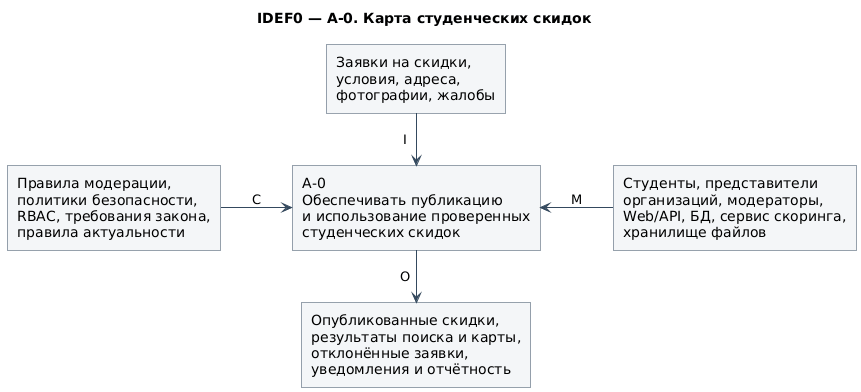
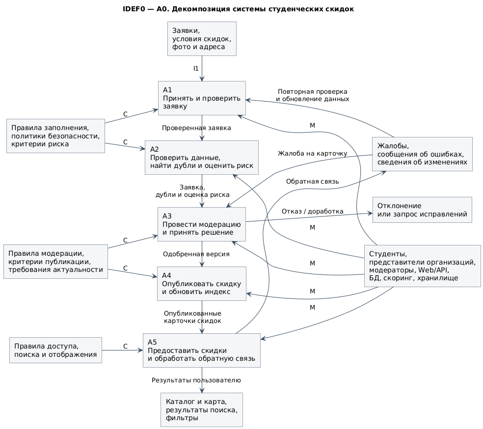

# IDEF0

## Контекстная диаграмма A0

## Декомпозиция A0
Функцию верхнего уровня разделяем на пять функциональных блоков:
- A1 — принять и проверить заявку;
- A2 — проверить данные, найти дубли и оценить риск;
- A3 — провести модерацию и принять решение;
- A4 — опубликовать скидку и обновить индекс;
- A5 — предоставить скидки пользователям и обрабатывать обратную связь.

## Блоки системы

| Блок | Вход                                          | Основной результат                                             |
| ---- | --------------------------------------------- | -------------------------------------------------------------- |
| A1   | Заявка, адрес, условия, фотографии            | Валидная заявка                                                |
| A2   | Валидная заявка                               | Оценка риска, найденные дубли                                  |
| A3   | Заявка и оценка риска                         | Одобрение, отказ или возврат на доработку                      |
| A4   | Одобренная версия                             | Опубликованная карточка и обновлённый поисковый индекс         |
| A5   | Опубликованные карточки и запрос пользователя | Карта, каталог, результаты поиска, обработанная обратная связь |